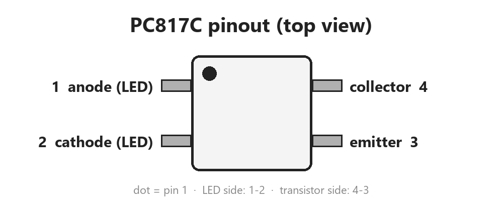
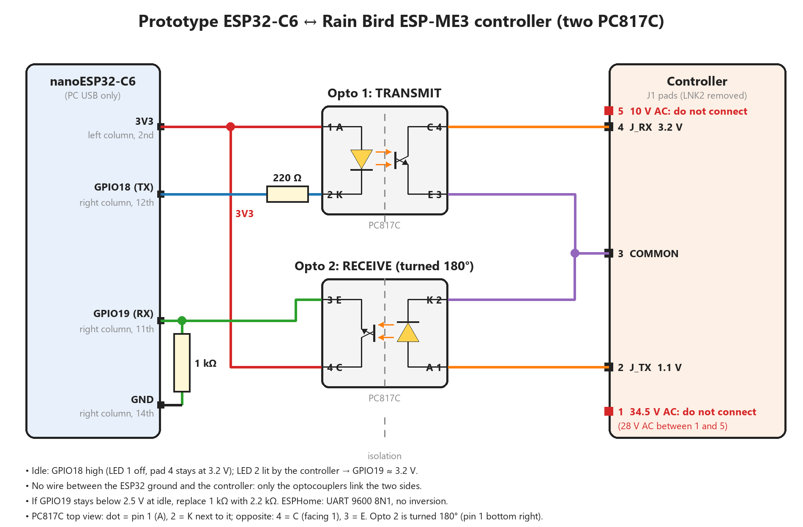

# Wiring of the ESP32-C6 ↔ ESP-ME3 prototype (01/11/2026)

*Français : [CABLAGE_PROTOTYPE_FR.md](CABLAGE_PROTOTYPE_FR.md)*

Reproduces the LNK2 circuit (traced on the LNK2 board) with two **PC817C** optocouplers (DIP-4).

Images generated by `outils/schema_cablage.py`.

## Board: MuseLab nanoESP32-C6 v1.0

Two USB-C ports: "CH343" (serial bridge on UART0, GPIO16/17 = TX/RX) and "ESP32C6" (native USB, the one plugged into
the PC: `COM6`, 303A:1001). Addressable RGB LED on the board. Top view, antenna up:
- left column: GND, 3V3, RST, 4, 5, 6, 7, 0, 1, 8, 10, 11, 12, 13, 5V;
- right column: GND, 2, 3, TX, RX, 15, 23, 22, **21, 20, 19, 18**, 9, GND, 5V.
GPIO18 (TX to the controller) and GPIO19 (RX) are on the right column, 12th and 11th pin from the top;
the nearest GND is the 14th pin of the right column, 3V3 the 2nd pin of the left column.

## PC817C pinout

## Diagram

- The two 24 V AC pins of the connector (pads 1 and 5) are **not** connected until a 24 V AC → 5 V supply is fitted.
- **No wire** between the ESP32 ground and the connector: only the optocouplers link the two sides.

- Transmit: GPIO18 idle high → LED off → transistor off → the controller sees its own pull-up (idle high),
  as with the LNK2. LED current ≈ (3.3 − 1.2) / 220 ≈ 9.5 mA.
- Receive: at idle the controller lights the LED → transistor on → GPIO19 ≈ 3.2 V (idle high,
  like GPIO25 of the LNK2). The 1 kΩ resistor to ground makes the falling edge fast enough for
  9600 baud (104 µs bit); if the high level stays below ~2.5 V, use 2.2 kΩ.
- ESPHome side: `uart:` 9600 8N1, `tx_pin: GPIO18`, `rx_pin: GPIO19`, **no inversion**.
- GPIO18 / GPIO19 chosen to avoid the strapping pins (4, 5, 8, 9, 15), USB (12, 13) and UART0
  (16, 17); adapt to your board.

## Survey of the LNK2's J1 connector (pads numbered 1 to 5 from left to right, back side, connector up)

- **Pad 3 (middle) = common J_COM**: connected to the cathode of U2 and the emitter of U3 (continuity, 01/11/2026).
- **Pad 2 = J_TX** (controller data output): anode of U2 (continuity, 01/11/2026).
- **Pad 4 = J_RX** (controller data input): collector of U3 (continuity, 01/11/2026).
- Pads 1 and 5: AC supply, **28 V AC between 1 and 5** (34.5 V AC between 1 and common,
  10 V AC between 5 and common: the common is not the neutral of the AC supply).
- Measurements of 01/11/2026 relative to pad 3:
  - LNK2 removed: pad 2 = 0 V, pad 4 = 3.2 V DC (controller pull-up, no load).
  - **LNK2 fitted, idle: pad 2 = 1.1 V DC** (U2's LED lit, current supplied and limited by the
    controller), **pad 4 = 3.2 V DC** (U3's transistor off).
  → The two-PC817C circuit is validated as drawn, with no resistor on the controller side.

## To check before connecting to the controller

1. **LNK2 unpowered, continuity** between the 4 top legs of U2/U3 (J1 side) and the 5 pads of J1:
   expected U2 anode → J_TX, U2 cathode → J_COM, U3 collector → J_RX, U3 emitter → J_COM, each ≈ 0 Ω.
   (U2: pin 1 = anode top right, 2 = cathode top left; U3: 4 = collector top
   left, 3 = emitter top right, seen from the back of the LNK2 board.)
2. **LNK2 removed, controller powered**, voltages on the controller's 5 pins relative to J_COM:
   two pins at ~24 V AC (supply), J_RX ≈ a few volts DC (pull-up), J_TX ≈ a few volts.
   If J_TX delivered a hard voltage without current limiting (> 2 V open-circuit and high current), add 330 Ω in series
   with the anode of opto 2.

## Later: standalone power supply

24 V AC → 5 V module on the two 24 V AC pins, 5 V output to the board's 5V pin. The ESP32 ground
will then be tied to the rectified 24 V AC (as on the LNK2): **never plug in the PC's USB at the same time**
(unless the USB cable is isolated), otherwise short circuit through the PC's earth.
