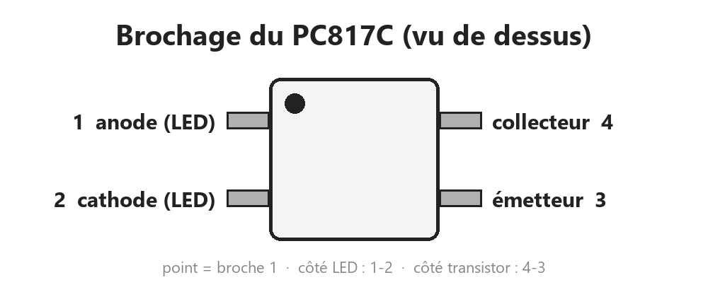
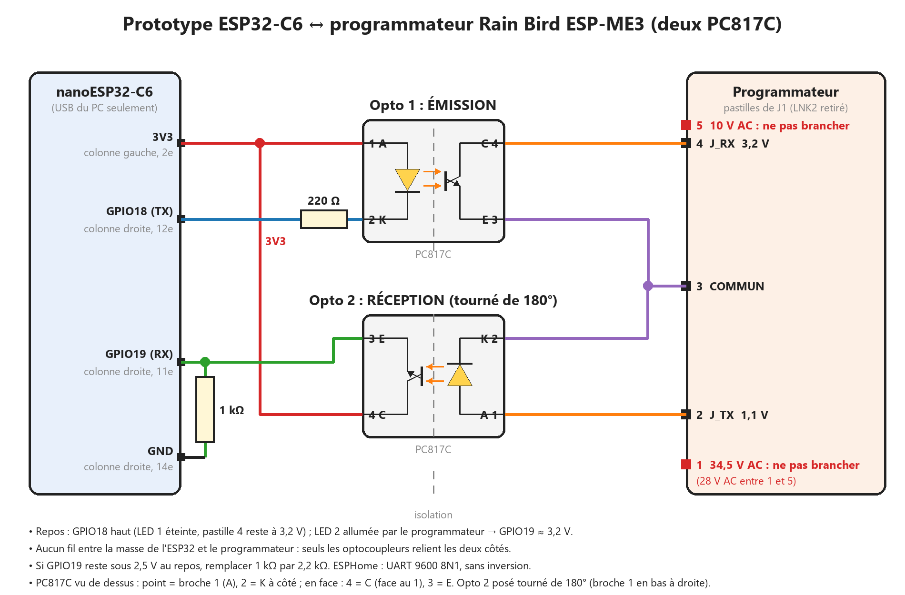

# Câblage du prototype ESP32-C6 ↔ ESP-ME3 (01/11/2026)

*English: [CABLAGE_PROTOTYPE.md](CABLAGE_PROTOTYPE.md)*

Reproduit le montage du LNK2 (relevé sur sa carte) avec deux optocoupleurs **PC817C** (DIP-4).

Images générées par `outils/schema_cablage.py`.

## Carte : MuseLab nanoESP32-C6 v1.0

Deux USB-C : « CH343 » (pont série sur l'UART0, GPIO16/17 = TX/RX) et « ESP32C6 » (USB natif, celui branché au
PC : `COM6`, 303A:1001). LED RGB adressable sur la carte. Vue de dessus, antenne en haut :
- colonne gauche : GND, 3V3, RST, 4, 5, 6, 7, 0, 1, 8, 10, 11, 12, 13, 5V ;
- colonne droite : GND, 2, 3, TX, RX, 15, 23, 22, **21, 20, 19, 18**, 9, GND, 5V.
GPIO18 (TX vers le programmateur) et GPIO19 (RX) sont sur la colonne droite, 12e et 11e broche depuis le haut ;
la GND la plus proche est la 14e broche de la colonne droite, le 3V3 la 2e broche de la colonne gauche.

## Brochage du PC817C

## Schéma

- Les deux broches 24 V AC du connecteur (pastilles 1 et 5) ne sont **pas** branchées tant qu'il n'y a pas d'alimentation 24 V AC → 5 V.
- **Aucun fil** entre la masse de l'ESP32 et le connecteur : seuls les optocoupleurs relient les deux côtés.

- Émission : GPIO18 au repos à l'état haut → LED éteinte → transistor bloqué → le programmateur voit son
  rappel (repos haut), comme avec le LNK2. Courant LED ≈ (3,3 − 1,2) / 220 ≈ 9,5 mA.
- Réception : au repos le programmateur allume la LED → transistor passant → GPIO19 ≈ 3,2 V (repos haut,
  comme GPIO25 du LNK2). La résistance de 1 kΩ vers la masse rend le front descendant assez rapide pour
  9600 bauds (bit de 104 µs) ; si le niveau haut reste sous ~2,5 V, passer à 2,2 kΩ.
- Côté ESPHome : `uart:` 9600 8N1, `tx_pin: GPIO18`, `rx_pin: GPIO19`, **sans inversion**.
- GPIO18 / GPIO19 choisis pour éviter les broches de démarrage (4, 5, 8, 9, 15), l'USB (12, 13) et l'UART0
  (16, 17) ; à adapter selon la carte.

## Relevé du connecteur J1 du LNK2 (pastilles numérotées 1 à 5 de gauche à droite, face arrière, connecteur en haut)

- **Pastille 3 (milieu) = commun J_COM** : reliée à la cathode de U2 et à l'émetteur de U3 (continuité, 01/11/2026).
- **Pastille 2 = J_TX** (sortie données du programmateur) : anode de U2 (continuité, 01/11/2026).
- **Pastille 4 = J_RX** (entrée données du programmateur) : collecteur de U3 (continuité, 01/11/2026).
- Pastilles 1 et 5 : alimentation alternative, **28 V AC entre 1 et 5** (34,5 V AC entre 1 et le commun,
  10 V AC entre 5 et le commun : le commun n'est pas le neutre de l'alternatif).
- Mesures du 01/11/2026 par rapport à la pastille 3 :
  - LNK2 retiré : pastille 2 = 0 V, pastille 4 = 3,2 V DC (rappel du programmateur à vide).
  - **LNK2 en place, au repos : pastille 2 = 1,1 V DC** (LED de U2 allumée, courant fourni et limité par le
    programmateur), **pastille 4 = 3,2 V DC** (transistor de U3 bloqué).
  → Le montage avec deux PC817C est validé tel que dessiné, sans résistance côté programmateur.

## À vérifier avant de brancher sur le programmateur

1. **LNK2 hors tension, continuité** entre les 4 pattes du haut de U2/U3 (côté J1) et les 5 pastilles de J1 :
   attendu U2 anode → J_TX, U2 cathode → J_COM, U3 collecteur → J_RX, U3 émetteur → J_COM, chacune ≈ 0 Ω.
   (U2 : broche 1 = anode en haut à droite, 2 = cathode en haut à gauche ; U3 : 4 = collecteur en haut à
   gauche, 3 = émetteur en haut à droite, vus de la face arrière de la carte du LNK2.)
2. **LNK2 retiré, programmateur sous tension**, tensions sur les 5 broches du programmateur par rapport à J_COM :
   deux broches à ~24 V AC (alimentation), J_RX ≈ quelques volts continus (rappel), J_TX ≈ quelques volts.
   Si J_TX délivrait une tension franche sans limitation (> 2 V à vide et fort courant), ajouter 330 Ω en série
   avec l'anode de l'opto 2.

## Plus tard : alimentation autonome

Module 24 V AC → 5 V sur les deux broches 24 V AC, sortie 5 V sur la broche 5V de la carte. La masse de l'ESP32
deviendra alors liée au 24 V AC redressé (comme sur le LNK2) : **ne plus brancher l'USB du PC en même temps**
(sauf câble USB isolé), sinon court-circuit par la terre du PC.
